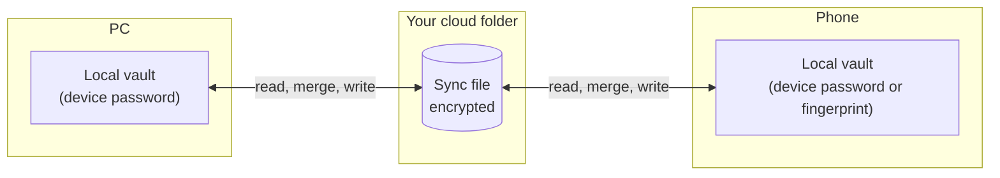
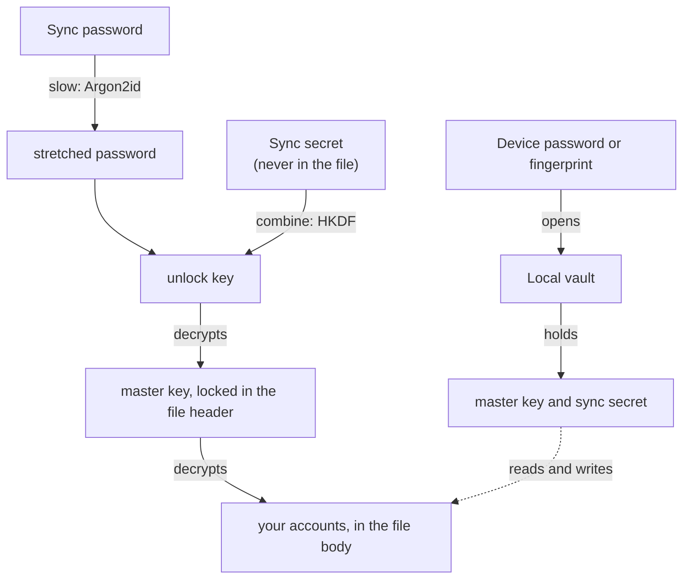

# Sync: how your accounts get to your other devices

> **Status: designed, not yet available.** Only the merge logic exists in the code. The design ([ADR-0018](adr/0018-sync-keys-secrets-and-merge-rules.md)) and the [file format](specs/sync-format-v1.md) are accepted; nothing here has had a security review.

Add an account on one device and it appears on the others. There is no mfa-provider server: your devices share one **encrypted file** that you place where your own cloud app (or Syncthing, or similar) carries it between them. Sync is off until you turn it on.

Each device keeps its own complete vault, so your codes work offline and survive the loss of the sync file.

## The secrets, and what each one does

| Name | What it is | Who knows it | What it opens |
|---|---|---|---|
| **Device password** | You choose it, one per device (they may differ) | You | The vault on that device |
| **Sync password** | You choose it, at least 12 characters | You | With the sync secret: the sync file, when a device joins |
| **Sync secret** | Random, made by the app | Your joined devices and your recovery sheet | With the sync password: the sync file, when a device joins |
| **Master key** | Random, made by the app; you never see it | Your joined devices | The contents of the sync file |
| **Vault key** | Random, one per device; you never see it | That device | That device's vault |

### Which password decrypts the sync secret?
**None, in the cloud: the sync secret is not in the sync file at all.** It is an *input*. The sync password and the sync secret together make the key that unlocks the master key.

On a device that has joined, the secret and the master key are stored inside that device's encrypted vault. Your **device password** (or fingerprint) opens the vault, and so gives the app both. That is why you do not type the sync password every day.

## Using sync

### Turn it on (first device)
1. Choose where the sync file goes.
2. Choose a sync password. A long passphrase that you use nowhere else is best.
3. Save the **recovery sheet** (see below).

### Add another device
You need three things: **the file**, **the sync secret** and **the sync password**.
1. On the new device choose "join", and pick the sync file.
2. Scan the QR code shown by a device that has already joined (it asks for its device password first), or type the secret from your recovery sheet.
3. Type the sync password.
4. Check the preview of what will be combined, and confirm.

The new device keeps its own password and fingerprint unlock. Accounts that are identical on both sides are not doubled.

### The recovery sheet
It holds the sync secret, as text and as a QR code. It holds **no password**. Keep it offline, away from the sync password, like a spare key. **If you lose all your joined devices and the sheet, nobody can open the sync file**, not even with the right password.

## How changes are combined
| Situation | Result |
|---|---|
| Both devices added accounts | Both get all of them |
| The same account was edited twice | The later edit wins |
| Deleted on one, edited earlier on the other | Deleted |
| Edited after it was deleted elsewhere | It comes back |
| Counter-based (HOTP) account used on both | The higher counter is kept |
| You reordered your list | Stays on that device only |

"Later" is judged by each device's clock, so keep clocks set automatically.

## Keeping it safe

### If someone gets a copy of the sync file
They need the sync secret **and** the sync password. The secret is 128 random bits, far too many to guess, so the file alone is not enough even if your password is weak. They can see that it is a sync file, an identifier, the key-derivation settings and its approximate size.

| What the attacker has | Can they read your accounts? |
|---|---|
| The sync file only | No |
| File and sync password | No (the secret is missing) |
| File and sync secret (for example a found recovery sheet) | Only by guessing the sync password: its strength matters here |
| File, secret and password | Yes |
| A joined device whose vault they can open | Yes |

### If someone can change the file
They can delete it, damage it or put back an old version. They cannot read it or slip in accounts without the master key.
- A damaged or altered file is reported and **not** overwritten. Your local vaults are intact; you can write a fresh sync file.
- A missing file is reported and not silently recreated.
- If the file is older than one a device has already seen, that device warns you. A device that is just joining cannot know this.

### Changing the password or the master key
| You want to | Use | Effect |
|---|---|---|
| Change the password as routine | **Change sync password** | Other joined devices carry on |
| React to a leak or a lost device | **Create a new master key** | New secret, new file location; every other device joins again |

Changing only the password is **not** enough after a leak: cloud services keep old versions, and the old password with the secret opens an old version and reveals the same master key.

### After a compromise
1. Secure your cloud account: new password, sign out other sessions.
2. Create a new master key, with a new sync password, in a new file. Join your devices again. Delete the old file and, if your cloud service allows it, its old versions.
3. **If the attacker may have opened the file or a device, set up two-factor authentication again on each service.** A new key protects only what is written from now on; it does nothing about secrets already read. Start with email, your password manager, banking and the cloud account.

### Advice
- Give your cloud account a strong password and two-factor sign-in. **Do not keep the only way into that account inside this app**: save its recovery codes elsewhere, or you could be locked out of your own sync file.
- Keep your account passwords somewhere other than where you keep these codes, so one leak does not give away both factors.

## Limits
- Sync is only as quick as your cloud app, and is not instant.
- One lost or compromised device means a new master key for all.
- Order of the list is not synced.
- Android with OneDrive: a first, small test (one phone, one run) could pick a file, keep access after a restart, and write changes that reached a PC. **The first read after a restart returned an old copy**; the next one was current. So a phone may briefly work from old data; changes made on each device are still combined at a later sync. Google Drive and other apps have not been tested.

## Roadmap
Following [ADR-0008](adr/0008-sync.md): (1) a file you choose, in a synced folder; (2) WebDAV; (3) direct Google Drive and OneDrive support. Only phase 1 is designed in detail. Progress: [TASK-0017](tasks/open/0017-vault-sync.md).
